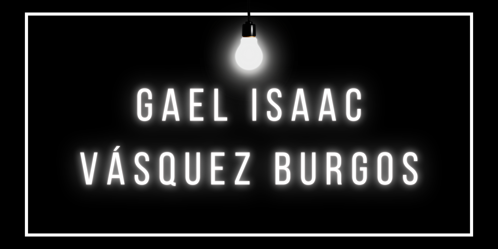

  

## 🚀 About Me
Full-Stack Developer focused on building scalable SaaS platforms, automated financial systems, and reservation engines for retail and local services. Trained at Conquer Academy, I leverage my natural curiosity and my professional background in music to bring deep discipline, structured logical problem-solving, and strong collaboration to engineering teams.
Bilingual in English (C1) and Spanish, eager to drive value within dynamic programming teams.
When I am not writing code, you will probably find me playing music, reading, or diving into a video game. 

## 🎓 Education & Certifications

* **Full-Stack Master Program** – Conquer Academy (Conquer Blocks)
* **Bilingual English/Spanish** – Professional Working Proficiency

---

## 🚀 Tech Stack

### Frontend

### Backend

                        

### Databases & Infrastructure

### Tools & Methods

----

## 🤝 Connect with me

<table>
  <tr>
    <!-- Botón de LinkedIn -->
    <td>
      
    </td>
    <!-- Botón de Correo -->
    <td>
      
    </td>
  </tr>
</table>

